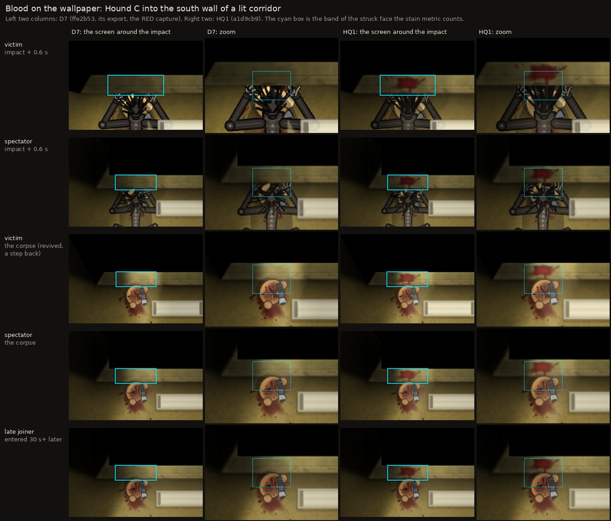
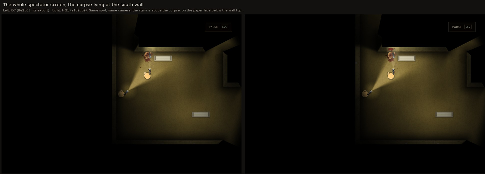
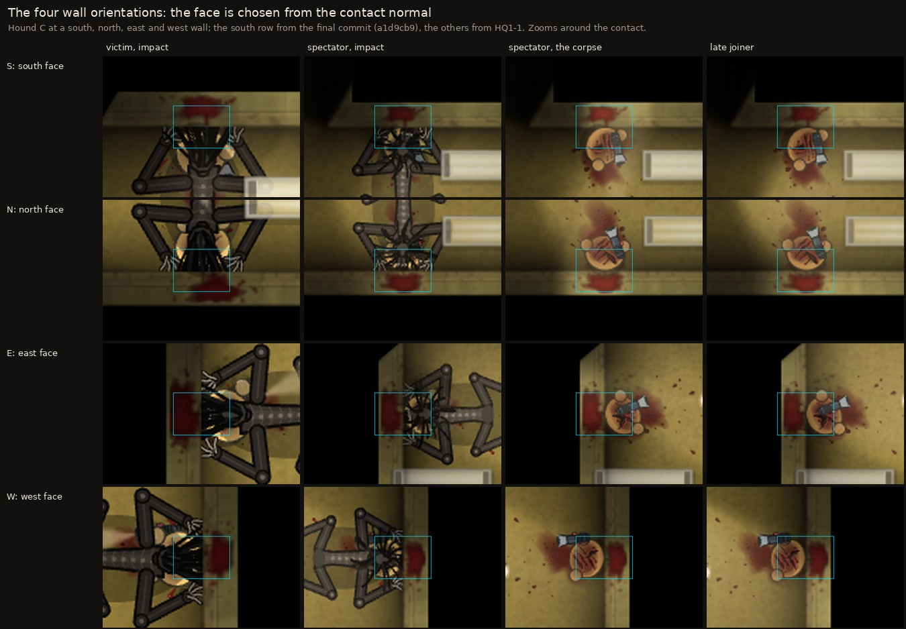
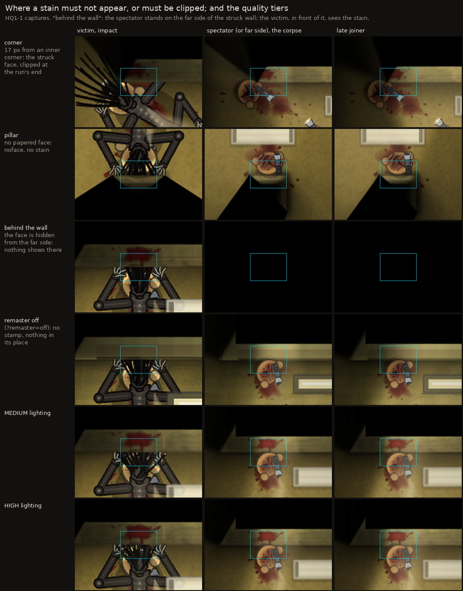
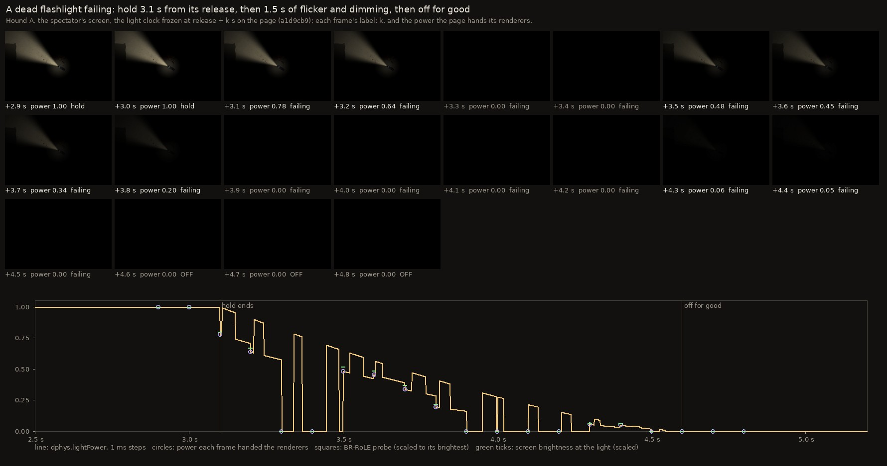
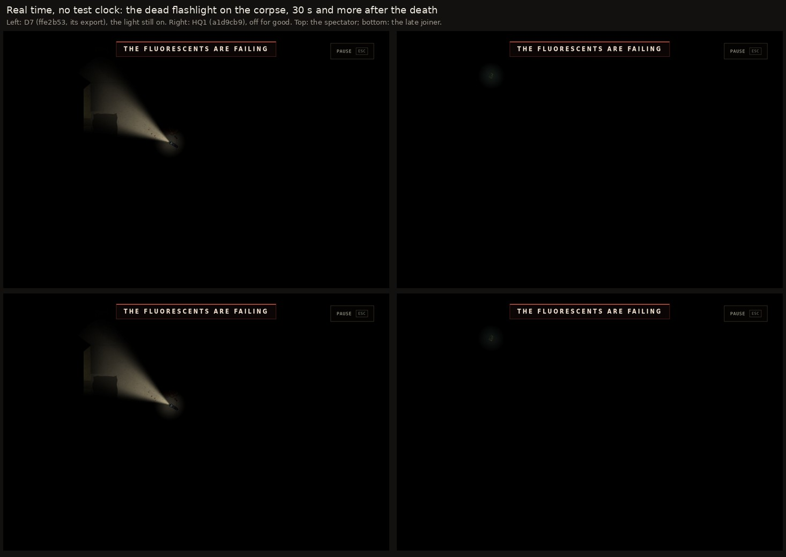

# Stage 3D HQ1: visual evidence

Every picture here is a screenshot of the real game, or a crop, scale or side-by-side of such screenshots:
- a real server and three browser pages: the victim, a spectator and a late joiner;
- deaths played through the admin Death Lab, which runs the real kill path;
- SwiftShader software rendering at 960 × 640, at the default quality (`low`) unless the picture says otherwise.

Nothing is painted onto the game's pixels except the labels in the dark bars and the cyan outline of the band box: the part of the struck face the stain metric counts. `dev/stage-3d-hq1/visual_evidence.py` composes the pictures from the captures, and names its sources.

No real GPU was used. A real screen may look different, which is what human QA is for.

## A. Blood on the wallpaper

### Hound C, south face, lit corridor: D7 against HQ1

`01_wall_south_D7_vs_HQ1.jpg`. Rows: the victim at the impact, the spectator at the impact, the victim (revived, a step back) looking at her corpse, the spectator looking at the corpse, and the late joiner. Columns: D7, then HQ1, each as the screen around the impact and a zoom.
- **D7** (`ffe2b53`, the RED capture of HQ1-0): blood on the carpet and at the foot of the wall; the wallpaper above it is clean.
- **HQ1** (`a1d9cb9`, the final source, captured in the final regression): a dark crimson splash on the wallpaper face itself, with spray along the wall and thin runs down to the carpet. It is there from the impact on, on every screen, and the late joiner sees the same stain.

`02_wall_south_whole_screen_D7_vs_HQ1.jpg`: the whole spectator screen, D7 on the left, HQ1 on the right. At this zoom the stain is a small mark above the corpse, on the paper face below the wall's dark top.

Blood-coloured pixels counted in the band box by `stain_metric.py` (gate W1: at least 150 after the death, where D7 has at most 10; nothing above the band):

| Capture | before: victim / spectator | impact: victim / spectator | corpse: victim / spectator | late joiner | above the band, any picture |
|---|---|---|---|---|---|
| D7 (RED), south | 0 / 0 | 0 / 0 | 0 / 0 | 0 | 0 |
| **HQ1, south (`a1d9cb9`, the final source)** | 0 / 0 | 389 / 199 | 167 / 166 | 190 | 0 |
| HQ1, north | 0 / 0 | 493 / 257 | 222 / 230 | 232 | 0 |
| HQ1, east | 0 / 0 | 408 / 362 | 337 / 343 | 345 | 0 |
| HQ1, west | 0 / 0 | 428 / 264 | 184 / 254 | 254 | 0 |
| HQ1, south, MEDIUM | 0 / 0 | 388 / 197 | 170 / 162 | 154 | 0 |
| HQ1, south, HIGH | 0 / 0 | 394 / 194 | 174 / 168 | 158 | 0 |
| HQ1, corner (half the box lies past the corner) | 0 / 0 | 0 / 26 | 91 / 87 | 85 | 0 |
| HQ1, pillar (no papered face: no stain; floor spray in the box) | 0 / 0 | 9 / 3 | 13 / 9 | 8 | 0 |
| HQ1, behind the wall (spectator and late joiner on the far side) | 0 / 0 | 287 / 0 | 174 / 0 | 0 | 0 |
| HQ1, remaster off | 0 / 0 | 0 / 0 | 0 / 0 | 0 | 0 |

### The four wall orientations

`03_wall_four_faces.jpg`: Hound C into south, north, east and west walls. The face is chosen from the contact normal each time, and the stain is on the face that was struck. The south row is from `a1d9cb9`, the final source; the other three are from HQ1-1.

### Corner, pillar, behind the wall, remaster off, quality tiers

`04_wall_corner_pillar_behind_off_tiers.jpg`, all from HQ1-1:
- **Corner.** The contact is 17 px from an inner corner. The stain is on the struck face, runs into the corner's shadow and stops at the end of the run. Half the band box lies past the corner, so it counts 85–91 pixels on the corpse and for the late joiner (at the impact it counts 0 and 26: the stain sits in the corner's shadow there, partly behind the hound, and the metric counts only bright enough red).
- **Pillar.** A pillar has no papered face, so there is no wall stain (`noface`). The few counted pixels are floor spray inside the box.
- **Behind the wall.** A spectator on the far side of the struck wall, and a late joiner placed there, see no stain: the line of sight hides that face. The victim, in front of it, sees it.
- **Remaster off** (`?remaster=off`). No stamp and nothing drawn in its place: no screen-space stain, nothing on the wall top. The floor blood is as at D7.
- **MEDIUM and HIGH.** The same stain, at the other quality tiers.

## B. Dying lights

### The failure, timecoded

`05_light_failure_timecoded.jpg`. A dead flashlight on the spectator's screen (a1d9cb9, Hound A, lamps off so the dead light is the only light). Its profile is hold 3.1 s and failure 1.5 s.

The page's light clock is frozen at release + k s with a test hook (`window.__deathLightNow`). Each frame is labelled with k, the power the page hands its renderers, and the phase.

The chart below the frames:
- **Line:** `dphys.lightPower` itself, in 1 ms steps.
- **Circles:** the power in each frame.
- **Squares:** BR-RoLE's own probe in front of the lens.
- **Green ticks:** the screen's brightness at the light.

The pattern: full through the hold, then flashes and blackouts under a falling envelope, then exactly 0 from the end, for good.

| Release + k | Power | BR-RoLE probe | Screen brightness at the light (0–255) | Phase |
|---|---|---|---|---|
| 2.9 s | 1.00 | 0.821 | 91.7 | hold |
| 3.0 s | 1.00 | 0.821 | 91.7 | hold |
| 3.1 s | 0.78 | 0.639 | 73.3 | failing |
| 3.2 s | 0.64 | 0.524 | 61.3 | failing |
| 3.3 s | 0.00 | 0.000 | 0.0 | failing |
| 3.4 s | 0.00 | 0.000 | 0.0 | failing |
| 3.5 s | 0.48 | 0.397 | 47.4 | failing |
| 3.6 s | 0.45 | 0.372 | 44.5 | failing |
| 3.7 s | 0.34 | 0.277 | 33.8 | failing |
| 3.8 s | 0.20 | 0.160 | 20.2 | failing |
| 3.9 s | 0.00 | 0.000 | 0.0 | failing |
| 4.0 s | 0.00 | 0.000 | 0.0 | failing |
| 4.1 s | 0.00 | 0.000 | 0.0 | failing |
| 4.2 s | 0.00 | 0.000 | 0.0 | failing |
| 4.3 s | 0.06 | 0.045 | 6.0 | failing |
| 4.4 s | 0.05 | 0.041 | 5.6 | failing |
| 4.5 s | 0.00 | 0.000 | 0.0 | failing |
| 4.6 s | 0.00 | 0.000 | 0.0 | **off for good** |
| 4.7 s | 0.00 | 0.000 | 0.0 | **off for good** |
| 4.8 s | 0.00 | 0.000 | 0.0 | **off for good** |

The clip of the same frames at 10 frames per second (0.1 s of light clock per frame, so real speed), with the timecode and a power bar below each frame:
- [`06_light_failure_10fps.mp4`](dev/stage-3d-hq1/evidence/visual/06_light_failure_10fps.mp4)
- [`06_light_failure_10fps.gif`](dev/stage-3d-hq1/evidence/visual/06_light_failure_10fps.gif)

The small greenish glow with a blinking red dot at the clip's top-left corner is not the dead light. It is the level's CARTOGRAPH item lying on the floor, which has its own glow; it does not change while the light fails.

### Real time, no test clock: D7 against HQ1

`07_light_realtime_corpse_D7_vs_HQ1.jpg`. The corpse 30 s and more after the death, with no test clock:
- **D7:** the dead flashlight still shines (it did, at 19–103 s).
- **HQ1:** it is dark, for the spectator and for the late joiner.

The real-time timing on every page, without a test clock, is in each run's JSON (`observed`):
- every frame through the hold at full power;
- no lit frame after the end (`litFramesAfterOff: 0`);
- the three pages put the end within 18.3 ms of each other with BR-RoLE and 1.3 ms with the game's own lighting, and each within 14.5 ms of a quiet observer of the server's messages (18.1 ms at most over every light run).

### Every light kind, and the other renderers

These are in `dev/stage-3d-hq1/evidence/hq1-2/timeline/`. Each run has:
- `_sequence_death.jpg` and `_sequence_corpse.jpg`: the frozen clock at 12 moments, on all three screens;
- `_strip.jpg`: the 0.1 s failure (flashlight, lantern and the game's own lighting; the others have none);
- `_realtime.jpg`: real time.

| Run | What it shows |
|---|---|
| `houndA_flashlight` | the flashlight: tumbles out early, holds, fails, off |
| `houndA_lantern` | the lantern: the same, as an all-round glow (hold 6.4 s: its real-time lit picture is on the victim's screen) |
| `houndA_headlamp` | the headlamp: stays on the head, its hold counted from the death's start |
| `houndA_camcorder` | nothing emitted at any time; no infrared from the dead camcorder |
| `houndA_flashlight_off` | switched off before the death: nothing at any time |
| `houndA_flashlight_legacy` | the game's own lighting (BR-RoLE off): the same timing and darkness. Run again on the final source, `a1d9cb9`: `evidence/hq1-3/hq1/timeline/houndA_flashlight_legacy_*` |
| `houndA_flashlight_high` | HIGH lighting: the same |
| `d7_baseline/d7_houndA_flashlight` | D7, for comparison: lit at every real-time picture, 19–103 s after the death |

## Notes on the captures

- **Software rendering is slow here.** On this two-core machine SwiftShader runs three pages at about one frame per second, and one screenshot takes seconds.
  - A short hold (3.1 s) has often ended before the first real-time picture can be taken.
  - So the light's sequence is shown with the frozen test clock. The real-time pictures show the start (where the hold is long enough) and the end.
  - The per-frame record (`observed`) covers real time exactly.
- **The labels show the commit that was checked out when the capture ran.**
  - HQ1-1's and HQ1-2's captures ran on the working tree just before each checkpoint's commit, so their labels name the previous commit (`dcf9f84`, `241d7da`).
  - The south-face wall capture and the flashlight timelines were run again in the final regression on `a1d9cb9`. Those are the ones shown above.
  - `a1d9cb9` holds the final source: the later checkpoints (HQ1-3, HQ1-4) add only tools, evidence and documents.
- **Every failed capture is kept** next to the passing ones, with what went wrong: `hq1-0/red/ATTEMPTS.md`, `hq1-1/attempts/`, `hq1-2/attempts/` and `hq1-2/timeline/attempts_harness_v1/`.
